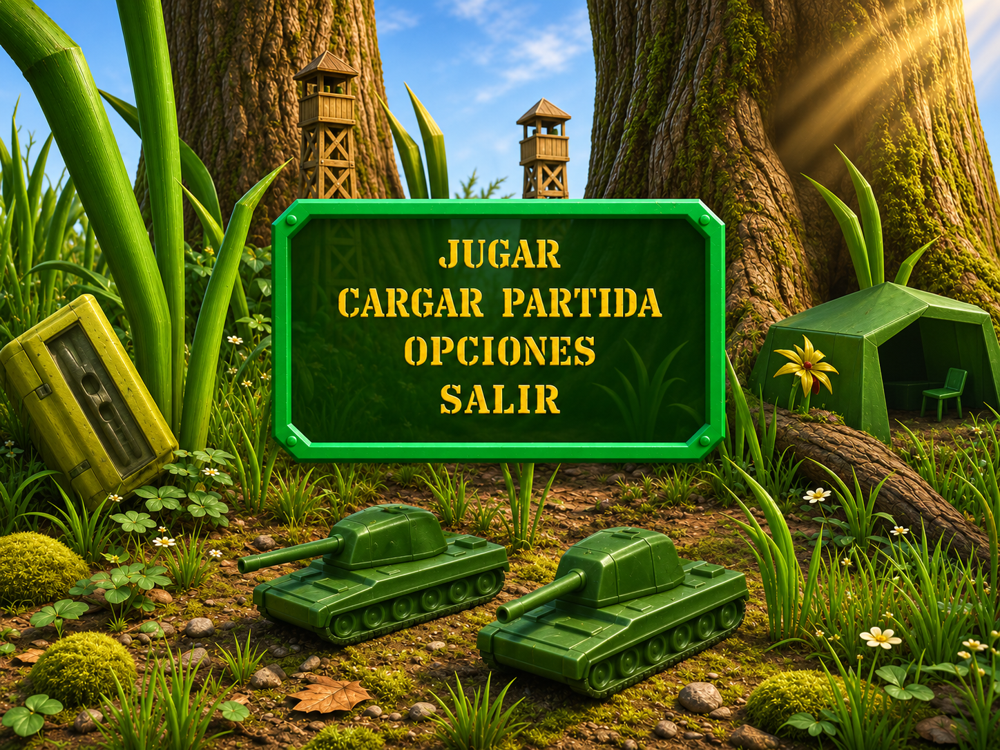

# Encargo para Muse: portada 3D fiel al original

Estado: preparado para que Muse lo tome; todavía no hay confirmación de inicio.
Dirección y revisión: Codex. Implementación pesada: Muse.

## Pedido de Fabián

Modernizar poco a poco Army Men: Air Attack para jugar en PC. La tarea inmediata
es mejorar la portada como la propuesta v2, tomando las formas del escenario y
los modelos del juego original y aumentando el realismo. Conservar la identidad
de juguetes de plástico, la escala diminuta y la composición del original.

La imagen es una propuesta generada y aplanada: sus letras no son botones.
La geometría y las proporciones de las capturas originales mandan si discrepan
de la propuesta. Fuentes y límites en [las referencias](docs/PORTADA-REFERENCIAS.md).

## Punto de partida comprobado

Revisión del 10 de noviembre de 2026 sobre `Master` en
`c6c0487c824601f5b6a83a5401b6823e13bf9c65`. Actualizar y comprobar el estado actual
antes de empezar: esta revisión no congela el trabajo de otros agentes.

- El menú WebGL de `index.html` ya recibió el PR #68: fondo del mundo en vivo,
  placa verde y animación CSS. Continuar desde ahí; aún falta el diorama de la
  referencia. La cámara que orbita el mundo de campaña no equivale a ese diorama.
- `src/ui.js`, `styles.css` y `src/game.js` controlan menú, estado y cámara;
  `src/toy-world.js` y `src/toy-renderer.js` construyen y dibujan el mundo.
- `assets/blender/tanque.py`, `assets/tanque-tan.gltf` y `src/modelo-tanque.js`
  son una recreación del tanque enemigo Tan, no una extracción del tanque verde
  de la portada. Revisar silueta y proporciones antes de reutilizarlos.
- `original/` contiene el vuelo de inspección sobre datos de Alpina 1; no es una
  campaña completa ni el menú original. `SHARED.MBL` y `SHELL.MBL` son distintos.
- El PR #65 de Muse contiene `native/godot/`; #66 lo amplía y tiene como base la
  rama de #65. #67 añade otro proyecto, `motor_original/`, para inspeccionar
  recursos locales. Ninguno de los tres está integrado en esta base de `Master`.
  No fusionarlos como requisito de una mejora de portada.
- La copia modificada del ejecutable de 3DO, con perfil de mouse, traducción y
  wrapper gráfico, vive fuera de este repo. Publicar aquí una escena WebGL o
  Godot no modifica automáticamente el menú de ese ejecutable.

## Primera entrega: diorama del menú actual, revisable en PC

Crear una rama desde el `Master` vigente, por ejemplo `muse/portada-diorama-v1`,
y abrir un PR pequeño. Implementar la portada en el menú WebGL que hoy abre
`index.html`. La adaptación al ejecutable original o a Godot será otro cambio
con su ruta de arranque y límites documentados. Mantener los prototipos existentes.

1. Construir una escena de menú separada del mundo de campaña, para que la
   decoración no altere colisiones, mapas, enemigos ni objetivos de las misiones.
   Reutilizar el renderizador actual cuando sea viable y explicar cualquier
   ampliación necesaria. Evitar introducir otro motor para este primer PR.
2. Componer tres grandes troncos, vegetación desproporcionada, dos tanques verdes
   pequeños en primer plano, torres de madera estrechas con riostras, tienda
   militar verde a la derecha y caja amarilla verdosa inclinada a la izquierda.
   Comparar primero una vista de materiales simples con la captura original.
3. Mejorar corteza, hojas, tierra, pequeñas piedras, costuras de molde y sombras
   de contacto. Luz cálida desde arriba a la derecha y reflejos contenidos del
   plástico. Los tanques conservan casco, torreta, orugas y cañón reconocibles;
   no convertirlos en vehículos de tamaño real ni añadir armadura inventada.
4. Reservar el centro para placa verde y tipografía amarilla legible. Dibujar
   etiquetas y controles con HTML/CSS accesible encima del 3D. La PNG incluida
   sirve de referencia de arte, no de interfaz publicada con botones pintados.
5. Permitir animación ambiental discreta, sin mareo ni reconstrucciones de malla
   cada cuadro. Respetar reducir movimiento y el ajuste de calidad. Mantener
   carga y navegación fluidas; informar FPS y equipo si se han medido de verdad.

### Navegación real

La composición deseada muestra **JUGAR · CARGAR PARTIDA · OPCIONES · SALIR**.
Conservar el acceso a ayuda, ajustes y demás funciones que ya existen, aunque
se organicen en una pantalla secundaria.

- Jugar abre la campaña actual; Opciones abre ajustes y permite volver.
- El repo guarda preferencias y mejores resultados, pero eso no prueba que
  pueda reanudar una partida. Si no existe guardado de partida, mostrar Cargar
  partida deshabilitado con una explicación breve, sin simular una carga.
- En navegador, Salir debe tener una acción compatible y claramente explicada
  (por ejemplo volver a la portada); no prometer cerrar una pestaña ajena.
  En una futura versión nativa puede cerrar el juego.
- Mantener navegación con teclado, foco visible, ratón y táctil. Esc vuelve o
  pausa según el estado; no deja teclas ni disparos retenidos.

### Resolución y alcance de los controles

Verificar la portada a **1440 × 1080 (4:3)** y **1920 × 1080 (16:9)**, sin
estirar los modelos ni recortar las opciones. La referencia PNG mide 1448 × 1086;
no es una captura de un render 1080p ya integrado. Conservar adaptación móvil.

El contrato deseado para el pilotaje de PC, para entregas posteriores, es:

| Entrada | Comportamiento pedido |
| --- | --- |
| Mouse horizontal | Girar el helicóptero sobre su eje hacia izquierda/derecha |
| W / S | Avanzar / retroceder |
| A / D | Desplazamiento lateral izquierdo / derecho |
| Clic izquierdo | Ametralladora |
| Clic derecho | Disparar el arma secundaria seleccionada |
| Rueda | Cambiar munición/arma secundaria disponible |

No sustituir el giro por apuntado absoluto al cursor sin indicar esa diferencia.
El perfil externo del juego original ya tiene estos controles; eso no demuestra
que el WebGL y los prototipos Godot los tengan. Revisar su cobertura por separado.
La portada no necesita reescribir ahora el vuelo ni añadir nuevas armas.
El objetivo de idioma sigue siendo textos y voces en español: conservar lo
existente y declarar lo que falte, sin presentar este PR visual como un doblaje.

## Trabajo pesado y siguiente entrega

Muse se encarga de modelado/retopología, UV y materiales, ampliaciones del
renderizador, escena de menú y su integración. Codex revisará fidelidad,
funcionamiento y evidencias del PR, y priorizará la siguiente iteración.

Si la fidelidad requiere estudiar `SHELL.MBL`, reutilizar primero el conocimiento
de los lectores existentes y comprobar el formato. Las notas de referencia
incluyen lo observado y lo que sigue siendo hipótesis. Conservar los archivos
instalados en modo de lectura. No hace falta terminar un extractor universal
para entregar una primera comparación visual útil del diorama.

Después de revisar la primera portada, proponer un segundo PR para materiales
o geometría que de verdad mejoren el parecido. La integración nativa requiere
resolver explícitamente las bases de #65/#66/#67; mantenerla separada de este PR.

## Entrega y comprobación

- [ ] PR con escena de menú real y diferencia visual frente al menú de #68.
- [ ] Capturas del mismo encuadre antes/después a 1440×1080 y 1920×1080;
      comparación de siluetas con la fuente original.
- [ ] Jugar, Opciones, volver, pausa y las demás opciones alcanzables funcionan;
      Cargar/Salir describen su capacidad real.
- [ ] Comprobar inicio de misión, regreso al menú y pérdida de foco, sin entrada
      atascada, errores nuevos de consola ni fuga de recursos al repetir.
- [ ] Ejecutar `node --test` y las pruebas de navegador pertinentes cuando el
      entorno lo permita. Adaptar los smoke que dependan de textos cambiados;
      no quitar cobertura para obtener verde. No afirmar comprobación visual a
      partir de pruebas sin pantalla ni de mocks de WebGL.
- [ ] Conservar scripts UMD/CommonJS y apertura `file://`. Si cambian recursos
      de ejecución, actualizar `VERSION` una vez en `src/bootstrap.js` según README.
- [ ] Registrar archivos tocados, comandos/resultados, capturas, rendimiento
      medido, pendientes y procedencia de assets en
      `docs/RESPUESTA-MUSE-PORTADA.md` dentro del PR.

No incluir ejecutables, DLL, PAK, audio o vídeos completos del juego instalado,
ni rutas personales o credenciales. La PNG de este encargo es arte generado de
referencia, no una copia de un archivo gráfico del disco. Revisar Git antes de
editar y preservar trabajo ajeno. No fusionar ni desplegar los cambios de
implementación como parte de este encargo: presentar el PR para revisión.

**Primer paso de Muse al leer esto:** confirmar en la tarea de GitHub qué rama
y revisión usará, qué puede ejecutar y cualquier impedimento concreto; después
empezar por la composición del diorama y entregar la primera vista revisable.
