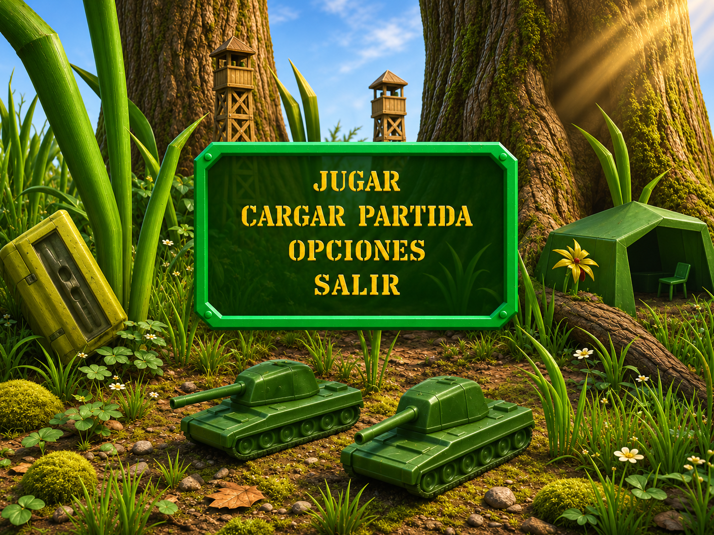

# Referencias de la portada para Muse

## Propuesta aprobada como dirección visual

`referencias/portada-v2.png`: imagen generada con ImageGen integrado, 1448×1086,
en proporción 4:3. Fabián pidió conservar el acabado atractivo de la primera
propuesta y acercar las formas a los modelos del juego original.
El [prompt exacto](referencias/prompt-portada-v2.txt) acompaña la referencia.

Es arte de concepto con textos dibujados, pendiente de implementación. No es
una captura de una escena nueva ya funcionando, ni una exportación de modelos.
El aspecto original tiene prioridad sobre posibles aproximaciones de esta PNG.

## Capturas del juego original

- [Diorama completo](https://www.myabandonware.com/media/screenshots/a/army-men-air-attack-x7b/army-men-air-attack_7.jpg):
  troncos, torres, caja inclinada, dos tanques y tienda verde.
- [Detalle](https://www.myabandonware.com/media/screenshots/a/army-men-air-attack-x7b/army-men-air-attack_8.jpg):
  tienda verde con entrada oscura, tanque, árbol y torre.
- [Galería de procedencia](https://www.myabandonware.com/game/army-men-air-attack-lab).

Se enlazan como referencia visual; no se adjuntan sus capturas ni una descarga
del juego al repositorio. Comparar cámara, siluetas y proporciones; el realismo
nuevo viene de iluminación, materiales y detalle de superficie.

## Investigación local del menú de PC: resultados y límites

Estos hallazgos son de una inspección local previa; necesitan validación contra
la edición que se abra. No tratarlos como un decodificador completo.

- El directorio PAK examinado empieza con un contador u32 y entradas de 52 bytes
  desde offset 4: nombre de 16 bytes, tamaño almacenado en +16, otro tamaño en
  +20 y campos en +24/+28. En esa edición los datos empiezan en `0x4000` y los
  tamaños almacenados suelen estar alineados a `0x800`. Verificar límites y
  suma de tamaños en cada archivo, sin aplicar offsets fijos a otras ediciones.
- `SHELL.PAK` contiene la escena de menú en `SHELL.MBL`. No confundirlo con
  `SHARED.MBL`, que los lectores de Alpina ya inspeccionan.
- `TITLE.TIM` es un logo, `STARTE.TIM` una etiqueta, `MENUBAR.TIM` una franja y
  `SPLASH.TIM` una imagen aparte. Reemplazar un TIM no demuestra haber cambiado
  el diorama 3D. Algunos recursos con extensión `.3DO` también son imágenes TIM;
  la extensión por sí sola no prueba que sean mallas.
- El `SHELL.MBL` inspeccionado tenía un bloque `AMDL` en `0x3bc`, con valores
  compatibles con 29 componentes, 1479 vértices y 1586 primitivas. Los vértices
  empezaban en AMDL+24 y usaban cuatro int16 de 8 bytes en total: x, y, z y un
  identificador de componente entre 0 y 28. No descartar el cuarto valor.
- La nube de vértices del componente 28 se identificó como **la tienda**, no
  como un tanque. Solo se obtuvo una superficie aproximada para inspección.
  No se han validado conectividad original de caras, UV, jerarquía ni materiales
  de ese bloque. No presentar esa aproximación como una malla original extraída.
- Los comandos de caras y transformaciones de `SHELL.MBL` siguen pendientes.
  El lector `3MDL` de `original/pak.js` es una referencia de código útil, pero
  hay que demostrar su compatibilidad con `AMDL` antes de aplicarlo al menú.

Las referencias del repo `docs/TANQUE-BLENDER.md` y
`docs/MODELOS-INTEGRADOS.md` describen modelos recreados. No cambiar su
procedencia a «extraídos del original» al usarlos en la nueva escena.

## Frentes ya existentes al preparar el encargo

- [PR #68, menú WebGL incorporado](https://github.com/fabianvs1997/army-men-ataque-aereo/pull/68).
- [PR #65 de Muse, arena Godot](https://github.com/fabianvs1997/army-men-ataque-aereo/pull/65).
- [PR #66, continuación nativa de #65](https://github.com/fabianvs1997/army-men-ataque-aereo/pull/66).
- [PR #67, lector nativo de recursos locales](https://github.com/fabianvs1997/army-men-ataque-aereo/pull/67).

El estado indicado corresponde al encargo del 2026-11-10. Comprobar las ramas
antes de trabajar; no copiar los tres prototipos en paralelo para una sola portada.
