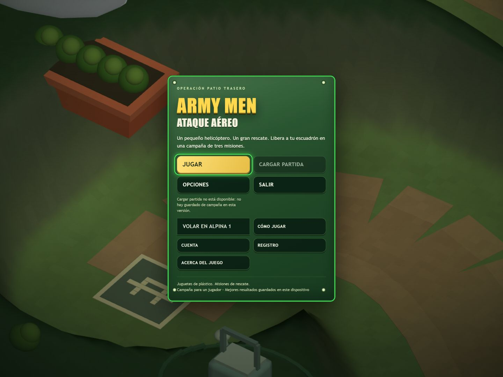
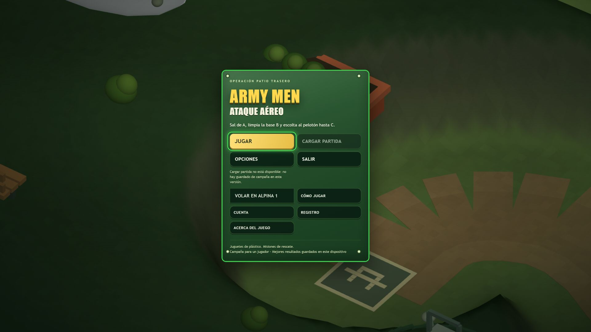

# Revisión de Codex de la primera entrega de Muse

Fecha: 2026-11-10. PR revisado: [#71](https://github.com/fabianvs1997/army-men-ataque-aereo/pull/71).
Código comprobado: `f7783108b0681930f6efd9e8ef7aa4bef0676a27`, incorporado
en Master por `1dcd663f108897c85bb4ab795779478b1e713d78`.

**Resultado: requiere correcciones.** El PR está fusionado, pero el diorama
nuevo no aparece en la aplicación real. Se comprobó tanto en la integración
Game → Draw3D como en el navegador. La revisión no fusionó ni desplegó cambios.

## Hallazgos reproducidos

### P1: el diorama no llega al renderizador

En `src/game.js`, la vista de compatibilidad que recibe `ToyDraw3D` no expone
`diorama`, `dioramaCam` ni `swayYaw`. Se crean en el estado, pero
`scene.diorama` queda indefinido en `src/draw3d.js`, por lo que se usa el
renderizado de campaña y no `renderDiorama()`.

Reproducción desde la raíz del repo:

```js
const { game } = require('./support/fake-host.cjs');
const g = game();
const calls = [];
g.state.renderer3d = {
  render: () => { calls.push('campaign'); return true; },
  renderDiorama: () => { calls.push('diorama'); return true; },
};
g.app.draw3d.draw();
console.log(g.state.diorama.length, typeof g.app.view.diorama, calls);
// 218, 'undefined', ['campaign']
```

Corregir la transmisión de datos a la vista y añadir una prueba de integración
que arranque `Game.create()` y verifique qué renderizador llama el menú. El test
actual que busca el texto `renderDiorama` en el código no detecta este fallo.

### P2: el reloj de animación del menú permanece detenido

`renderDiorama` recibe `scene.t`, que solo avanza en `upd()` durante la partida.
Al ejecutar los callbacks del bucle a 1000, 1020 y 1040 ms en estado de menú,
`t` permanece en 0 mientras `rot` llega a 2,7. Tras conectar el diorama, su
vegetación y nubes seguirían congeladas aunque no se pida reducir movimiento.

Usar un reloj propio del menú que avance con el bucle y llegue al renderizador.
Probar que su tiempo cambia entre cuadros y que el tiempo de simulación de la
campaña permanece detenido. Conservar las reglas de reducir movimiento y
documento oculto.

### P2: cada cono tiene una tapa horizontal sobrante en la punta

La rama compartida `cylinder`/`cone` de `geometry()` en `src/toy-renderer.js`
siempre agrega un disco superior de radio completo a y=0,5. En el cono solo
debe haber un vértice en la punta, no ese disco. Se detectaron 28 vértices de
borde en la tapa superior del cono, con normal vertical, además de las caras
laterales. Afecta a hierba, raíces y techos de la escena nueva.

Conservar la tapa superior en el cilindro; quitarla en el cono y comprobar su
geometría, incluidas caras degeneradas, con una prueba que cubra la superficie.

## Comprobaciones realizadas

- `node --test`: **357 pasan, 0 fallan, 4 omitidas**, 361 casos en total.
  Esto confirma la ejecución de la suite; los fallos anteriores quedan fuera
  de su cobertura actual.
- Navegador real con WebGL, servido localmente desde la revisión indicada:
  **1440×1080 y 1920×1080**, dimensiones verificadas en el DOM y las capturas.
- Opciones → Ajustes → Volver funciona. Salir muestra su explicación y permite
  volver. Cargar partida permanece deshabilitado con una explicación visible.
- Jugar abre la misión 1; Pausa abre Continuar; Volver al menú principal abre
  la confirmación y devuelve a la portada tras abandonar la partida de prueba.
- Sin mensajes de error o aviso en la consola durante esa secuencia. No se
  completó una campaña ni se midieron FPS del diorama, que aún no se dibuja.

La suite regenera las cabeceras de cuatro modelos embebidos usando separadores
de ruta de Windows. Se comprobó que solo variaban esos comentarios y se
retiraron esos cambios de prueba; no forman parte de esta revisión.

## Capturas reales de lo que aparece actualmente

Son capturas del navegador; muestran el mundo de campaña detrás de la placa,
no el diorama de troncos, tanques y tienda. No se alteró el código para
simular que la integración funcionaba.





## Siguiente encargo a Muse

1. Crear `muse/portada-correcciones-v1` desde el Master vigente, que ya incluye
   #71, y corregir los tres hallazgos en un PR nuevo.
2. Añadir las pruebas de comportamiento descritas, ejecutar la suite y
   actualizar `docs/RESPUESTA-MUSE-PORTADA.md` con resultados y límites reales.
3. Conservar botones, navegación y campaña. Ajustar los smoke de navegador que
   todavía buscan «Iniciar campaña» o «Ajustes» con las etiquetas antiguas,
   manteniendo sus comprobaciones de comportamiento.
4. Entregar el PR a Codex para verificar las vistas a ambos tamaños, animación,
   reducir movimiento, contexto WebGL y regreso desde la campaña. No fusionar
   ni desplegar desde este encargo.

La evaluación final de parecido y realismo sigue pendiente hasta ver el
diorama funcionando. Conectar la escena es el primer paso; las 218 piezas
procedurales y los diagramas de composición no bastan para aprobar el acabado
visual frente a la referencia v2.
